# Set up the Desk dashboard on your own old phone

This guide turns an old Android phone into an always-on desk display: a big clock, weather, a photo slideshow, a calendar, countdowns and a focus timer. It takes about 20 minutes.

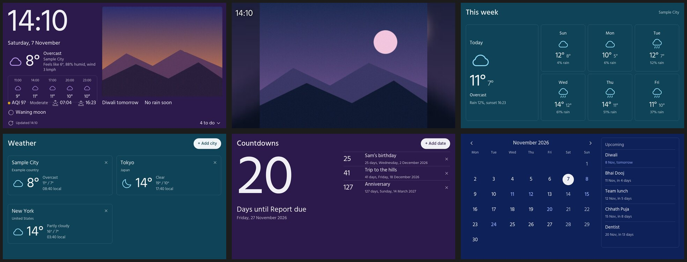

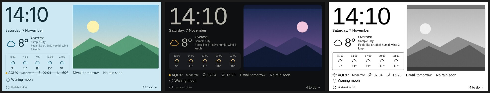

<details>
<summary>See every page in each style</summary>

**Modern dark**

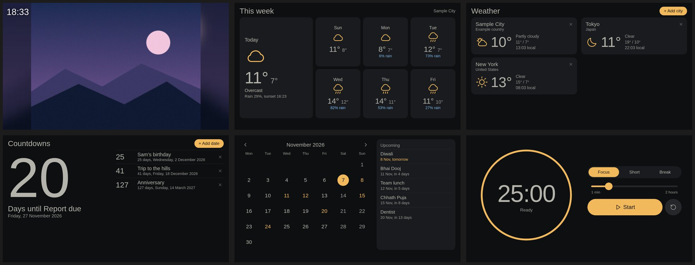

**Light (photo colours, pastel)**

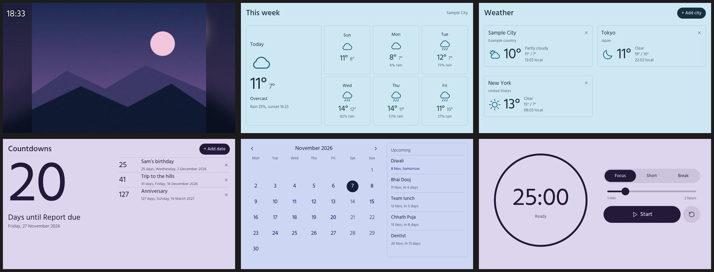

**E-ink** (black and white, no shading)

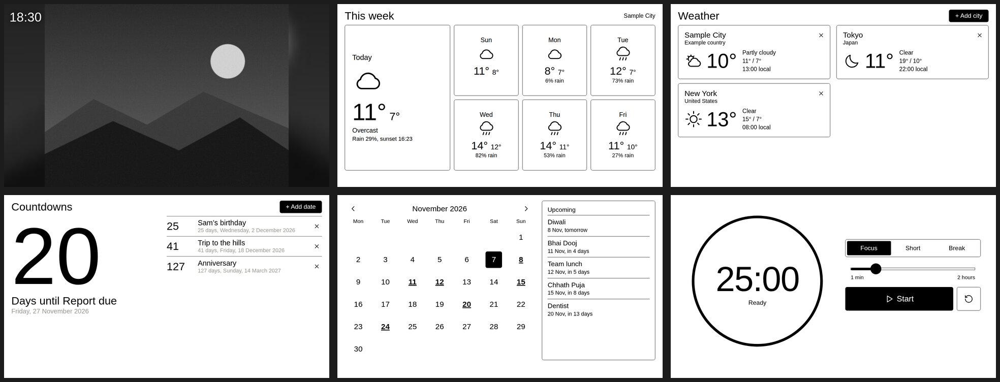

</details>

*Screenshots use sample data. The pages shown are Home, Photos, This week, Weather, Countdowns and Calendar. The styles are Photo colours, Modern dark and E-ink.*

1. [What you need](#1-what-you-need)
2. [Step by step](#2-step-by-step)
3. [What it can do, with screenshots](#3-what-it-can-do)
4. [Which phones work](#4-which-phones-work)
5. [Wi-Fi and security](#5-wi-fi-and-security)
6. [When something goes wrong](#6-when-something-goes-wrong)

## 1. What you need

**A laptop or desktop (Linux)**

| Needed for | What |
|---|---|
| Everything | Python 3.7 or newer, `adb` (Android Debug Bridge) |
| Photos | ImageMagick (the `convert` command) and any web browser |
| Building the app yourself (optional) | `default-jdk aapt android-sdk-platform-23 dalvik-exchange apksigner zipalign curl zip unzip` |

On Debian or Ubuntu: `sudo apt install adb imagemagick`. The tools use only Python's standard library, so there is nothing to `pip install`. This project was only run on Linux; it may work on macOS or Windows, but nobody has tried.

**The phone**

- Android 4.4 or newer (see [section 4](#4-which-phones-work) for what has been tested)
- A USB cable and a charger. The phone will sit plugged in all the time
- Wi-Fi at home. No SIM card or mobile data is needed
- A few MB of free space for the app, plus about 1.3 MB for each photo
- No Google account, no Play Store sign-in

**Where the laptop and phone must be**

- The same Wi-Fi network, once the first setup is done. During setup the USB cable is enough

## 2. Step by step

### Step 1: Get the code

```bash
git clone https://github.com/joo7/desk-dashboard.git
cd desk-dashboard
```

### Step 2: Prepare the phone

1. Open **Settings > About phone** and tap **Build number** seven times. A message says you are now a developer.
2. Go back to **Settings > Developer options** and switch on **USB debugging**.
3. Join your home Wi-Fi network.
4. Plug the phone into the laptop with the USB cable.
5. A box asks **Allow USB debugging?** Tap **OK**. Tick *Always allow from this computer* only on a laptop you trust.

Check that the laptop can see the phone:

```bash
adb devices
```

You should see one line ending in `device`. If it says `unauthorized`, unlock the phone and accept the box. If the list is empty, try another cable (some cables only charge).

### Step 3: Run the setup

```bash
python3 tools/sync.py setup
```

This does five things and prints each one:

1. Finds the phone and remembers it in `.phone_serial`. From now on the tool only talks to this phone, even if you plug in others.
2. Switches the phone to automatic brightness, keeps the screen on while it is charging, and sets the clock from the network.
3. Reads the phone's Wi-Fi address.
4. Switches `adb` to work over Wi-Fi (port 5555), so you can unplug the cable.
5. Sends the dashboard files to the phone.

When you have finished setting up, run `adb usb` to switch Wi-Fi `adb` off again (see [section 5](#5-wi-fi-and-security)).

### Step 4: Install the Desk app

```bash
python3 tools/sync.py app
```

This installs `dist/DeskDash.apk`, then reopens the dashboard full screen. The app hides the status and navigation bars, keeps the screen on, starts again by itself after a restart, and reopens within about 5 minutes if it ever crashes.

> **Want to be sure what you install?** The file in `dist/` was built by the repository's author. To build your own copy from the source instead, install the build tools from section 1 and run `android/build.sh`. `sync.py app` installs the newest build it finds.

### Step 5: Set your place

The first push created `web/data.js` from a template. Open it and change at least the place:

```js
place: { auto: true, name: "Your City", lat: 51.5074, lon: -0.1278 },
```

- `auto: true` lets the phone find its own position and uses `lat`/`lon` only when it can't. `auto: false` always uses the place you typed and does no location lookups at all (see [section 5](#5-wi-fi-and-security))
- To get `lat` and `lon`, right-click your street on any online map and copy the two numbers
- Other options in the same file: 24-hour or AM/PM clock, which day the week starts on, the hours when the screen goes dark, and your own calendar events

Send the change to the phone:

```bash
python3 tools/sync.py push
```

`web/data.js` holds your location, so it is not committed to git.

### Step 6: Add your photos

```bash
python3 tools/photos_ui.py
```

A page opens in your browser (it runs only on your laptop). Drag pictures onto it, or click **Add photos**. They are resized and sent straight to the phone, and the dashboard shows them within about 10 seconds without restarting. You can also **Hide**, **Show** or **Delete** photos that are already on the phone.

The phone keeps a 1280-pixel copy of each picture, not your original, and the laptop keeps nothing once the page is closed. Keep your originals somewhere safe. To add a whole folder at once instead: `python3 tools/sync.py photos <folder>`.

### Step 7: Make the phone behave as a display

These are optional but worth doing. All of them can be undone in Settings.

| Setting | Why |
|---|---|
| **Location**: on. Choose **High accuracy**, or **Battery saving** if you want the GPS off | The dashboard finds your position and weather from it. If Google asks *Improve location accuracy?*, tap **Agree** |
| **Brightness**: Automatic | Dim in a dark room. The screen is the biggest user of power |
| **Airplane mode** on, then switch **Wi-Fi** back on | Turns off the mobile radio when there is no SIM |
| Leave it plugged in | The screen stays on while charging |

**Look after the battery.** A phone kept at 100% for months ages quickly. This phone cannot stop charging by itself, so the dashboard shows **Unplug charger** in the bottom line at 80% and above, and **Plug in charger** at 30% and below. A cheap timer plug on the charger does it automatically.

### Step 8: Everyday use

| Command | What it does |
|---|---|
| `python3 tools/sync.py push` | Send changes after editing anything in `web/` |
| `python3 tools/photos_ui.py` | Manage the photos |
| `python3 tools/sync.py todo list` | Read the to-do list. Also `add "text"`, `done N`, `rm N` |
| `python3 tools/sync.py doctor` | Test the connection and find what is slow |

On the phone: **swipe sideways** to change page, **drag up or down** to scroll, **tap the right or left of a photo** for the next or previous one, and tap the **gear** for settings.

**After the phone restarts**, `adb` over Wi-Fi switches itself off. The dashboard comes back on its own, but to send changes you need to plug in USB once and run `python3 tools/sync.py setup` again.

## 3. What it can do

Swipe sideways through seven pages. Every screenshot here shows the real dashboard page at the phone's screen size, with generated sample pictures and a made-up place.

> **How these were made.** They were rendered from the same page in desktop Chrome at 1280 × 720, not photographed from a phone. On a real Android 4.4 phone the fonts and spacing may differ slightly.

### The seven pages

**Home** shows the clock, the date, the weather now and the next five time slots, a photo, air quality, sunrise and sunset, the next holiday, and whether rain is coming. A refresh button on the left of the bottom line updates your position and weather (once a minute at most). Drag up to reach the to-do list.

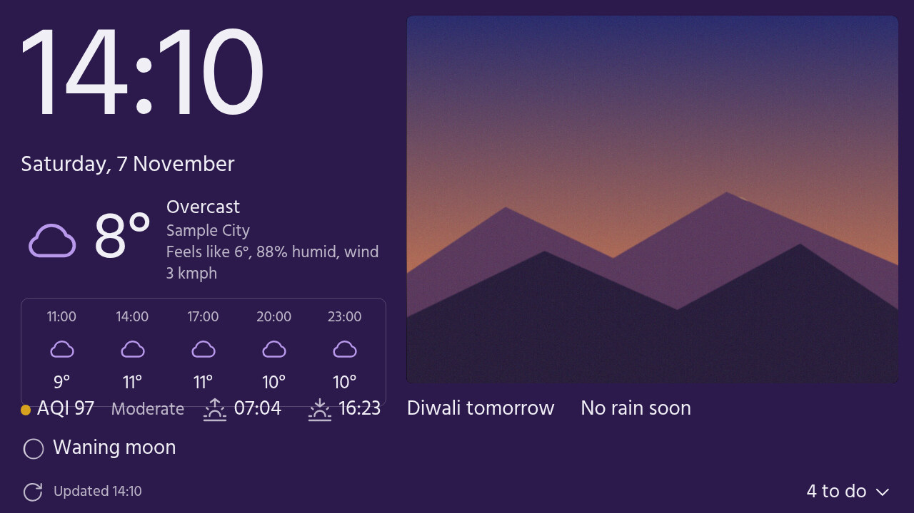

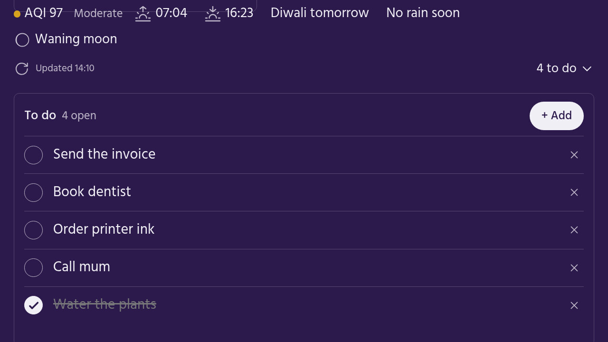

**Photos** is a full-screen slideshow. Tap the left third for the previous photo and the rest for the next.

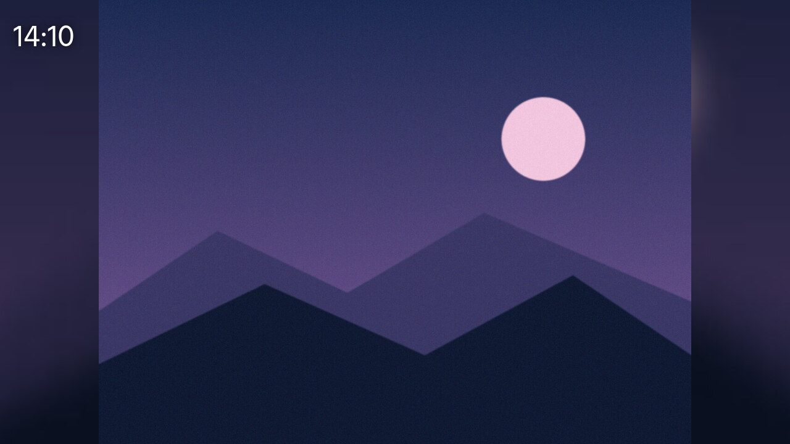

**This week** shows today in detail and the next six days.

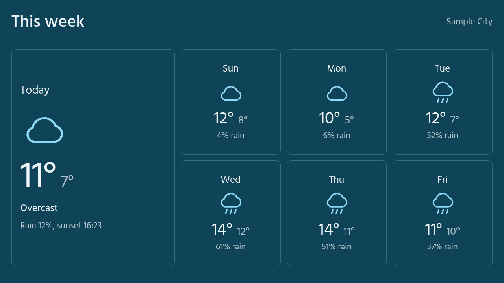

**Weather** shows as many cities as you like. Tap **+ Add city** and search by name.

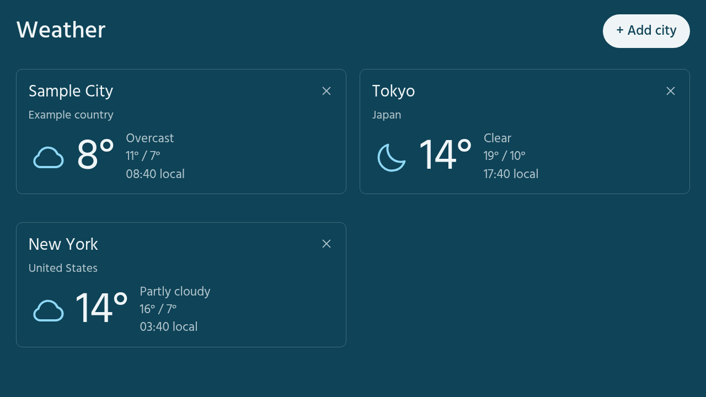

**Countdowns** counts the days left until trips, birthdays and deadlines. Yearly ones repeat.

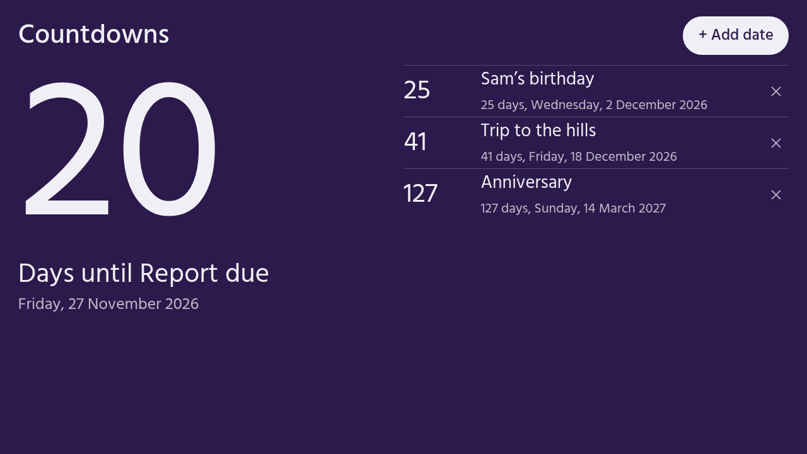

**Calendar** shows the month, your own events and the next holidays. Holidays are the Indian national and festival dates for 2026 and 2027, from `web/holidays.js`.

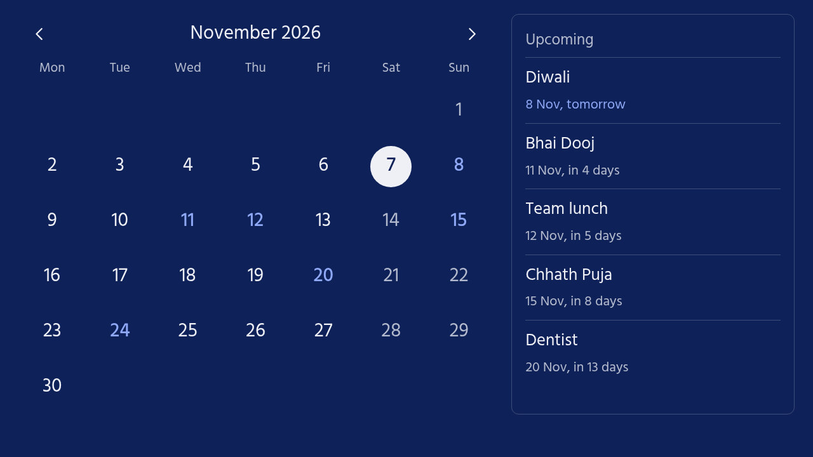

**Focus** is a timer that beeps when it ends. Use the presets, or drag the slider from 1 minute to 2 hours.

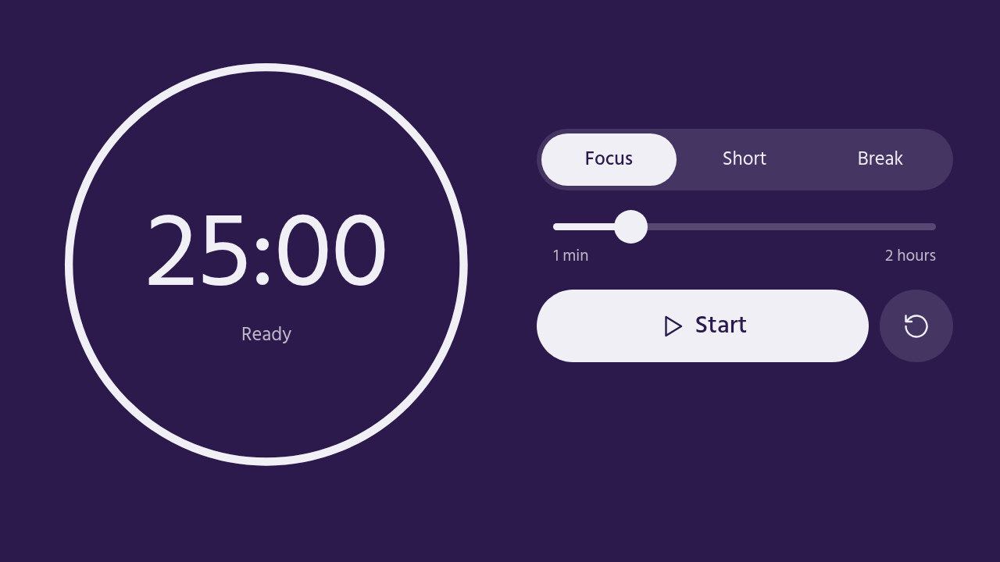

A **Habits** page is also built in. It is off by default; set `habits: true` in `web/data.js` to bring it back.

### The gear menu

Tap the gear (it appears when you touch the screen and fades after a few seconds) to change how often the photo changes (5 seconds to 1 hour), the style, colour or black-and-white photos, when the background goes dark, and the location (automatic, or a place you choose).

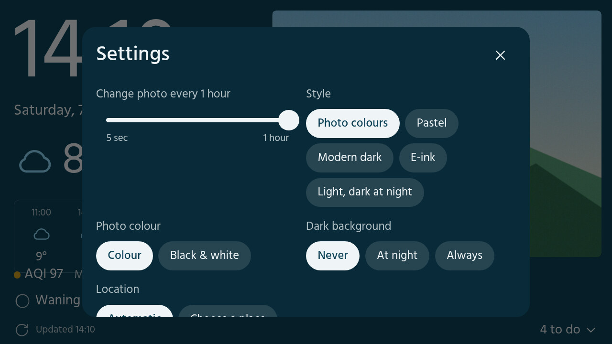

### Styles

| Photo colours (default) | Pastel |
|---|---|
|  | 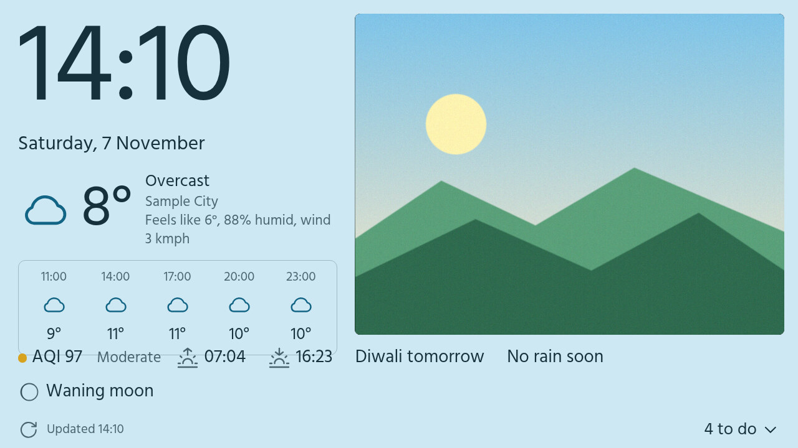 |
| **Modern dark** | **E-ink** |
| 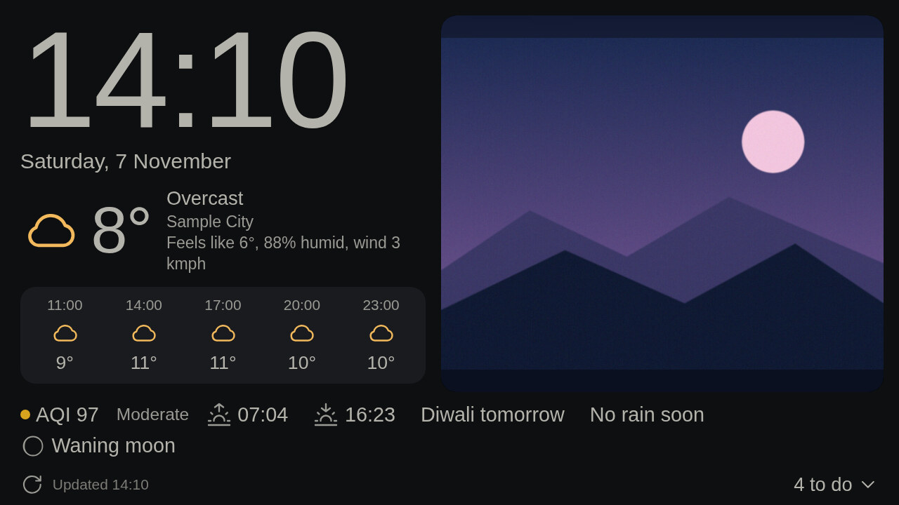 | 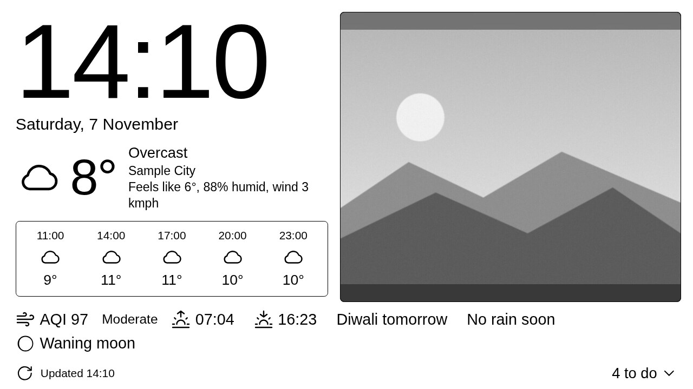 |

*Photo colours* takes its colours from the current photo, so the whole dashboard changes with each picture. *E-ink* is plain black and white and suits a paper-like screen. A fifth style, *Light, dark at night*, is also available.

### Portrait

Turn the phone and the layout follows. (Your phone's rotation lock is respected.)

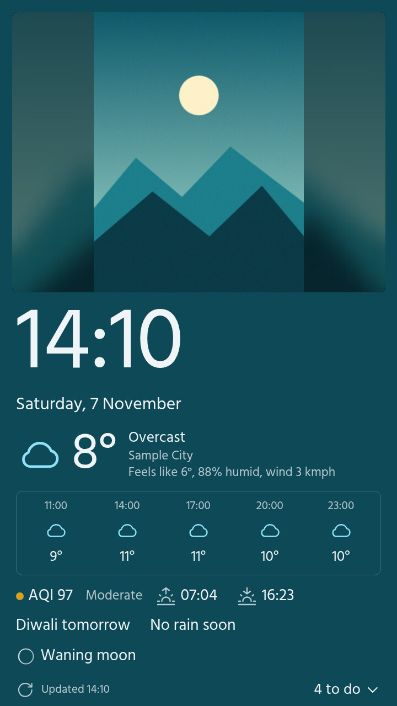

## 4. Which phones work

| Phone | Status |
|---|---|
| **Honor Holly (Hol-U19), Android 4.4.2, 720 × 1280, 1 GB RAM** | **Tested.** This is the phone the project was built and run on |
| Other Android 4.4 phones | Should work. The app is built for Android 4.4 (API 19) as its minimum |
| Android 5 to 9 | The app should install, but this has **not been tested** |
| Android 10 and newer | **Not tested.** These versions limit what an app can do with shared storage and starting itself, so expect problems |
| Android 4.3 and older | **Not supported** |

**Screen size.** The layout scales with the screen, but it has only been checked on a 720p screen. A very small or very large screen is untested.

**Limits to know about**

- The text is English only. Temperatures are in Celsius and wind in km/h, with no setting to change them
- The built-in holidays are Indian ones for 2026 and 2027. For other countries, edit `web/holidays.js`
- Weather and air quality come from [Open-Meteo](https://open-meteo.com), which needs no account. Place names come from OpenStreetMap
- Photos can be JPG, PNG, WebP or GIF. iPhone HEIC files are converted if your ImageMagick can read them, but this has not been tested
- `setup` finds the phone's Wi-Fi address with a command that newer Android versions may not have. If it can't, USB still works

## 5. Wi-Fi and security

- **Safe to use at home.** Apart from Wi-Fi `adb` (see the next line), nothing on the phone accepts connections from your Wi-Fi, and the phone only sends weather and location requests out. Only use it on a network you trust, and don't sign in to any account on it, because Android 4.4 no longer gets security updates.
- **After setup, run `adb usb`** with the phone plugged in. That switches Wi-Fi `adb`, the one way into the phone, off again. A phone restart does the same.
- **Location:** with `auto: true` the dashboard sends your rough location to weather and map services. Set `auto: false` in `web/data.js` to stop that.

## 6. When something goes wrong

Run `python3 tools/sync.py doctor` first. It checks every step and writes timings to `sync.log`.

| What you see | What to do |
|---|---|
| `adb devices` shows `unauthorized` | Unlock the phone and tap **OK** on the *Allow USB debugging?* box. If it doesn't appear, switch USB debugging off and on |
| `Phone not found` after a restart | Wi-Fi `adb` resets when the phone restarts. Plug in USB and run `python3 tools/sync.py setup` again |
| `adb devices` shows nothing | Try another USB cable or port. Many cables are charge-only |
| `INSTALL_FAILED_UPDATE_INCOMPATIBLE` | An app signed with a different key is installed. Run `adb uninstall com.deskdash`, then `sync.py app` again. Your to-do list and settings come back from their saved copies |
| The screen is blank, or shows `JS error` | Run `python3 tools/sync.py push` again, then `doctor`. The error text is in the bottom line; tap it to read it in full |
| No location, or weather for the wrong place | Check **Settings > Location** is on and accept Google's *Improve location accuracy?* box. If location stops updating after you change a location setting, restart the phone. Or set `auto: false` and type your place |
| The photo page says *Your phone isn't connected* | Plug in USB, or run `setup` again. The page checks again every 10 seconds and updates by itself |
| The footer says **Unplug charger** | The battery is at 80% or more while charging. This is the battery reminder |

To go back to how the phone was: uninstall the app (`adb uninstall com.deskdash`), delete `/sdcard/dash` with `adb shell rm -r /sdcard/dash`, then undo the settings you changed in Settings.
